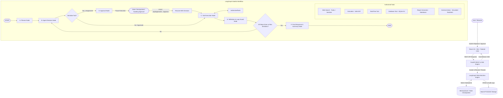
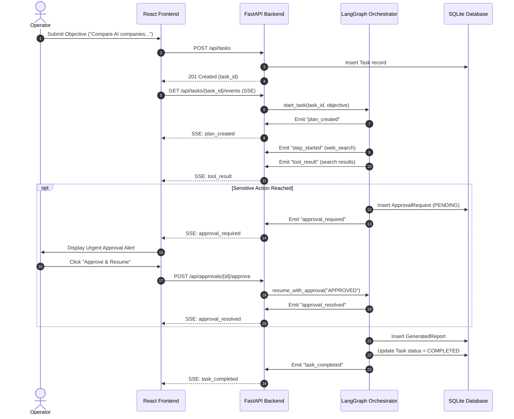

# AgentFlow AI – System Architecture & Technical Design

## 1. Executive Summary

**AgentFlow AI** is a production-grade, stateful autonomous research and workflow orchestration platform. It translates high-level natural language user objectives into verified, multi-step execution graphs powered by LangGraph, FastAPI, and React.

The system incorporates **Human-in-the-Loop (HITL)** safety gates, allowing autonomous agents to execute research and analysis freely while pausing execution for administrative approval prior to triggering sensitive external actions.

---

## 2. High-Level Architecture Diagram

---

## 3. Core Component Breakdown

### A. Planner Node (`app/graph/nodes.py`)
- Analyzes the natural language objective submitted by the user.
- Employs Google Gemini 1.5 (or the built-in deterministic planning fallback).
- Decomposes goals into 3 to 6 ordered execution steps.
- Identifies required tools and tags sensitive operations requiring human oversight.
- Persists steps into the SQLite `task_steps` table and broadcasts `plan_created` over SSE.

### B. Agent Decision Node
- Inspects current workflow state, remaining planned steps, and past tool outputs.
- Synthesizes arguments for the designated tool.
- Updates the active task step status to `RUNNING` in the database.
- Emits real-time `step_started` event to connected clients.

### C. Tool Execution Engine (`app/tools/`)
The platform enforces strict tool allowlisting:
1. **Web Search Tool (`app/tools/web_search.py`):**
   - Connects to Tavily Search API.
   - Includes prompt injection sanitization (`sanitize_search_content`) to neutralize injection attempts such as `"Ignore previous instructions"` or malicious scripts embedded in external web snippets.
   - Fallback mode provides structured intelligence if an API key is not configured.
2. **Safe Calculator Tool (`app/tools/calculator.py`):**
   - Evaluates arithmetic and algebraic expressions exclusively via Python's Abstract Syntax Tree (`ast.parse`).
   - Zero use of `eval()` or `exec()`.
   - Hardened against infinite loop power attacks (e.g. `999999 ** 999999`) and zero division.
3. **Date and Time Tool (`app/tools/datetime_tool.py`):**
   - Retrieves UTC ISO timestamps, localized dates, day of week, and epoch timestamps.
4. **Task Database Tool (`app/tools/db_tool.py`):**
   - Provides task-scoped persistent key-value memory (`save_task_data`, `get_task_data`, `list_task_data`).
5. **Report Generation Tool (`app/tools/report_tool.py`):**
   - Synthesizes formatted Markdown research documents and stores records in `generated_reports`.
6. **External Action Tool (`app/tools/external_action.py`):**
   - Simulates sensitive operations (e.g., dispatching broadcast notices, creating external project tickets).
   - Marked with `is_sensitive = True`.

### D. Human-in-the-Loop (HITL) Approval Node
- When an action flagged as sensitive is reached, the agent routes to `approval_node`.
- The node creates an `ApprovalRequest` record in SQLite, marks the task `WAITING_APPROVAL`, and emits an `approval_required` event over SSE.
- The LangGraph workflow pauses and checkpoints its exact state.
- Operators can review the action description and raw parameters in the **Approval Center** or **Live Execution Console**.
- Upon calling `POST /api/approvals/{id}/approve` or `POST /api/approvals/{id}/reject`:
  - `APPROVED`: Resumes workflow, executes tool, and continues to reflection.
  - `REJECTED`: Records rejection feedback; the agent adapts and continues without executing the sensitive action.

### E. Reflection & Loop Prevention Node
- Evaluates intermediate observations against the original objective.
- Increments `iteration_count` against `MAX_AGENT_ITERATIONS` to prevent infinite loops.
- Emits real-time `reflection` SSE events.

### F. Final Response Node
- Compiles the final executive summary.
- Links generated Markdown reports and cited research sources.
- Marks task `COMPLETED` and emits `task_completed`.

---

## 4. Real-time Communication Architecture

---

## 5. Security & Reliability Guardrails

- **Zero API Key Leakage:** Keys are loaded via server-side environment variables and never surfaced to client payloads or logs.
- **AST Math Evaluation:** Math expressions are evaluated with Python AST node traversal. Arbitrary code, system calls, or shell invocations are rejected.
- **Prompt Injection Defense:** Content scraped from external web searches passes through regular expression sanitizers that neutralize prompt override patterns (`Ignore previous instructions`, `system: you are`, `<script>`).
- **Loop Limits:** Maximum iteration thresholds enforce strict graph termination.

